  

 

  <a href="https://www.linkedin.com/in/reia-baid">linkedin</a> · <a href="https://github.com/reiabaid?tab=repositories">repositories</a> · <a href="mailto:baidreia@gmail.com">email</a>

 

### `01` / selected work

a thread through the work: make things explainable, make them reliable, make them useful to someone real.

<table cellpadding="14">
  <tr>
    <td width="50%" height="105" valign="top">
      <b><a href="https://github.com/reiabaid/cuda-vision-pipeline">cuda-vision-pipeline</a></b>
       
      cuda image kernels, bit-exact vs opencv, ~88% of peak memory bandwidth.
        
      CUDA · C++ · OpenCV · Nsight
    </td>
    <td width="50%" height="105" valign="top">
      <b><a href="https://github.com/reiabaid/temporal-engine">temporal-engine</a></b>
       
      deterministic time engine + mcp server, so llm agents never lose track of time. 360 tests.
        
      Python · MCP · event sourcing
    </td>
  </tr>
  <tr>
    <td width="50%" height="105" valign="top">
      <b><a href="https://github.com/reiabaid/SCOPE">SCOPE</a></b>
       
      explainable npm risk scanner - a model scores packages 0 to 1, SHAP shows why. cli, web app, github action.
        
      Python · scikit-learn · SHAP · FastAPI
    </td>
    <td width="50%" height="105" valign="top">
      <b><a href="https://lock-in-livid-nine.vercel.app/">Lock-In</a></b>
       
      a chat-first accountability app. an ai partner plans your day and learns your pace.
        
      React PWA · FastAPI · PostgreSQL
    </td>
  </tr>
</table>

### `02` / what i'm working on

<table cellpadding="14">
  <tr>
    <td colspan="2" valign="top">
      <b>testing</b>
       
      whether giving ai agents a reliable clock makes them make fewer mistakes.
    </td>
  </tr>
  <tr>
    <td colspan="2" valign="top">
      <b>learning</b>
       
      deep learning, how computers are built, and how operating systems work.
    </td>
  </tr>
</table>

### `03` / stack

  

### `04` / activity

  <picture>
    <source media="(prefers-color-scheme: dark)" srcset="https://github-readme-activity-graph.vercel.app/graph?username=reiabaid&bg_color=0d1117&color=8b949e&line=fb923c&point=fde8c8&area=true&area_color=f59e0b&hide_border=true" />
    
  </picture>

### `05` / stats

  <picture>
    <source media="(prefers-color-scheme: dark)" srcset="https://github-readme-stats.vercel.app/api?username=reiabaid&show_icons=true&hide_border=true&count_private=true&bg_color=0d1117&title_color=fb923c&text_color=c9d1d9&icon_color=84a98c" />
    
  </picture>
  &nbsp;&nbsp;&nbsp;
  <picture>
    <source media="(prefers-color-scheme: dark)" srcset="https://streak-stats.demolab.com?user=reiabaid&background=0d1117&ring=fb923c&fire=f59e0b&currStreakLabel=84a98c&sideLabels=8b949e&dates=8b949e&currStreakNum=e6e6e6&sideNums=e6e6e6&hide_border=true" />
    
  </picture>

  open to ml / computer vision internships for summer 2027

  

